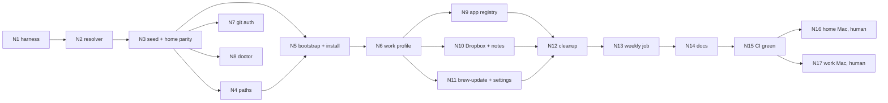
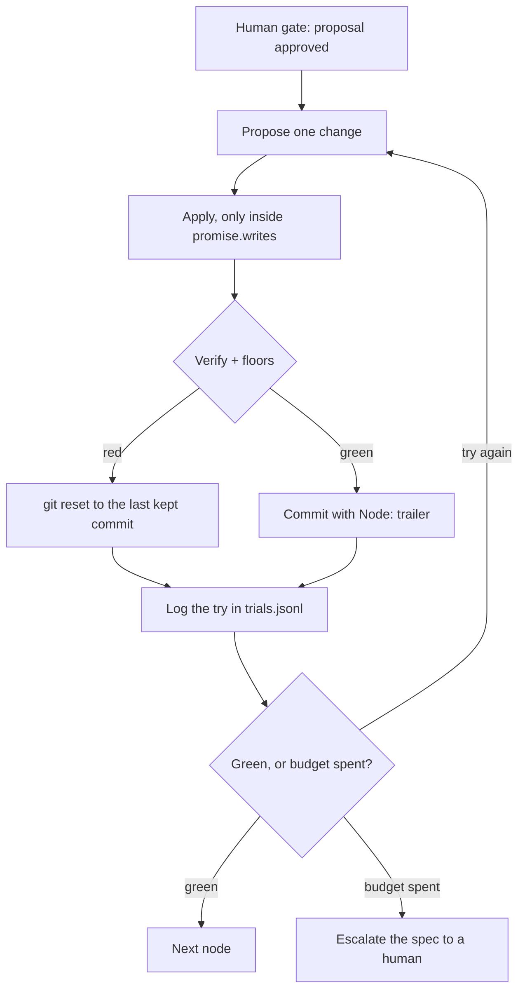

# How the overhaul was run: a graph of nodes, each closed by a loop

This folder records how the profile-driven bootstrap was built, so the method can be reused. Two graphs are kept apart:

- **The work graph** (what happened): [`graph.yaml`](graph.yaml) declares the nodes; git history records each kept try
  as a commit with a `Node:` trailer; [`trials.jsonl`](trials.jsonl) logs every try, kept or not.
- **The knowledge graph** (what is in force): [`../decisions/`](../decisions/README.md) holds small notes, one fact
  each: decisions (`adr`), invariants, patterns and vocabulary. Notes are never edited; a newer note `supersedes` an
  older one.

Bridges between them: a node or commit `Honors:` a note, and a node `mints` one.

## The nodes

Each node in `graph.yaml` states its objective, what it may read and write (`promise`), its `verify` commands, the
floors every node must keep (home parity, an idempotent second run), what happens when the try budget runs out, and its
human gate.

## The loop inside each node

The rules ([`program.md`](program.md)): a verify command is never weakened to pass; a check that belongs to a later node
reports **XFAIL** with that node's id and becomes a **FAIL** once a commit with that `Node:` trailer exists; a check
that passes early is **XPASS**, reported and then promoted. Nothing is skipped silently.

## What made it work

- **Write the harness first (N1).** Later nodes loop against tests that already exist, so "done" is a command, not an
  opinion.
- **Parity before deletion.** `scripts/test/check-parity` proved the generated home install equals the old one (minus
  agreed changes, listed in [`home-parity.json`](home-parity.json)) before any old file was removed.
- **Values, not branches.** Home and work differ only in values in `manifest.json`; no script asks which profile it is.
- **Reality wins over the plan.** Each node re-read the files and tools it touched first; every difference is in the
  trial log and the commit message.

## Files

| File                                       | Purpose                                            |
| ------------------------------------------ | -------------------------------------------------- |
| [`graph.yaml`](graph.yaml)                 | Nodes, dependencies, promises, verify, human gates |
| [`program.md`](program.md)                 | The control file: loop, rules, budgets, trial log  |
| [`trials.jsonl`](trials.jsonl)             | One line per try                                   |
| [`home-parity.json`](home-parity.json)     | Baseline commit and the agreed changes from it     |
| [`mise-scoreboard.md`](mise-scoreboard.md) | Weekly mise results for the work profile           |
